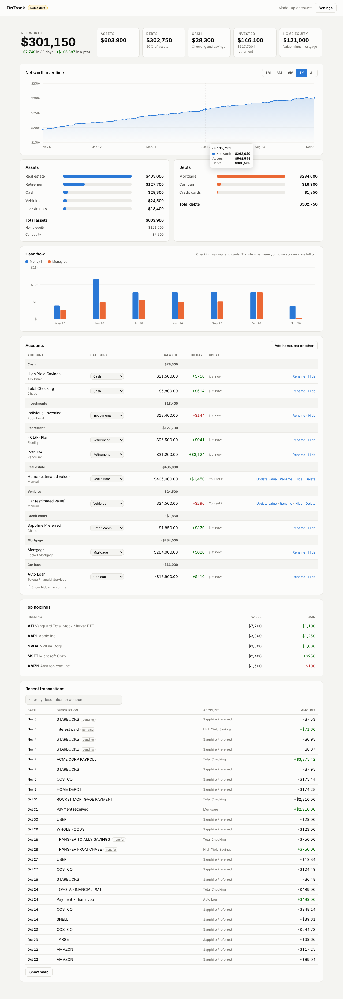

# FinTrack

A personal finance dashboard that keeps itself up to date. It pulls balances and transactions from your bank, brokerage (Robinhood), 401(k), car loan and mortgage through [SimpleFIN Bridge](https://bridge.simplefin.org) on a schedule, so you never type in numbers. Anything SimpleFIN can't see, like your home's value, you add once by hand.



**What it shows:** net worth and how it changed over 30 days and a year, a net worth chart with history built up one point per day (switch it to **By type** to see retirement, investments, cash, home equity, car and other debts stacked up to your net worth), assets and debts by category, home and car equity, monthly money in and out (transfers between your own accounts are left out, loan payments count as money out), every account with its 30-day change, top holdings with gains (where the brokerage reports them), and recent transactions you can search.

## Run it

You need [Node.js](https://nodejs.org) 20 or newer. There's nothing to install.

```bash
npm run demo     # made-up accounts, nothing saved: http://localhost:4600
npm start        # your accounts: http://localhost:4600
npm test
```

## Finding your way

The dashboard has five tabs: **Overview** (net worth, its chart, assets and debts), **Investments** (the 401(k) chart, investment mix, holdings), **Savings & budget** (buckets, income and expenses, cash flow), **Loans**, and **Accounts** (every account and recent transactions). The tab is part of the address (`#loans`), so a bookmark or refresh keeps it. Click a card's title (▾) to collapse it; collapsed cards stay collapsed.

## Connect your accounts (once)

1. Make an account at [bridge.simplefin.org](https://bridge.simplefin.org) (about $15 a year).
2. In SimpleFIN Bridge, connect each institution: your bank, Robinhood, your 401(k) provider (Fidelity, Vanguard, Empower, ...), and your loan servicers.
3. Make a **New connection** and copy its **Setup Token**.
4. Run `npm start`, open http://localhost:4600, paste the token and press **Connect**.

From then on FinTrack syncs on its own every 6 hours while it's running (change it in Settings). SimpleFIN refreshes from banks about once a day. To keep it syncing, leave it running on a computer that stays on, or start it at login (see below).

**Fix categories once.** FinTrack guesses each account's type from its name (401(k) → Retirement, Robinhood → Investments, Toyota Financial → Car loan, ...). If a guess is wrong, pick the right one in the Accounts table and it sticks. Hide accounts you don't want counted.

**A 401(k) SimpleFIN can't reach (like Paychex Flex).** Use **Add 401(k) by holdings**. Enter what each fund is worth (or how many shares you hold) as of a day's close, and how much goes in each paycheck and how it's split. FinTrack then:

- looks up each fund's closing price every day (Yahoo Finance; it covers mutual funds) and works out the balance from your shares;
- adds each paycheck's contribution on its own, as an estimate, at that day's price (for example: paid the last business day of the month, invested 3 business days later);
- reinvests fund payouts (dividends and capital gains, which drop a fund's price), so the balance doesn't dip when a fund pays out.

A **value vs. money put in** chart shows the account's value each trading day against its starting balance plus contributions since; the gap is what the market did. To give it a history, import older transaction files (Paychex goes back to Jan 1, 2025): FinTrack works backward from your share counts, undoing each contribution, exchange, fee and reinvested payout, and values each day with the funds' real prices. The files must cover every day up to the date your values are from, without a gap (keep Paychex's file names, which carry the dates). Payouts a file doesn't list are filled in from the funds' published payouts; where the files can't be right (shares would go below zero, or a fund has no prices that far back) the history stops and the card says why. The account shows what's estimated ("Estimated since Nov 5: 1 paycheck ($1,715.86)"). To make it exact, download your transactions from Paychex Flex (Retirement → Transactions → Download) and use **Import transactions**: the real contributions, payouts and fees replace the estimates for the dates the file covers. Importing the same file twice doesn't count anything twice. A Paychex transactions file in the setup form fills in the funds, the contribution and the split for you. If you move money between funds, use **Edit holdings** and enter the new values.

**Mortgage and other loans.** The balance syncs from your lender. Click **Add loan details** on the loan (or on the mortgage card) and enter the interest rate, what you pay each month, the escrow in it (taxes, insurance, PMI), and, if you pay more than what's due, the required payment from your statement: the card then splits each payment into interest, principal and your extra, and shows how much sooner the extra pays it off and the interest it saves. Optionally add the amount borrowed, the term and the first payment month: FinTrack then shows your original payoff date and suggests the escrow. The loan's card shows:

- what's left, the monthly payment split into loan and escrow, and how the next payment splits into interest and principal;
- the payoff date and the interest still to pay at your current payment;
- **What if you paid more?** A slider for extra each month and a box for a one-time payment: the new payoff date, how much sooner, and the interest saved, with both balances on a chart;
- this year's interest, principal and escrow (estimated until FinTrack has tracked the loan since January 1; your Form 1098 has the exact interest);
- a year-by-year schedule.

**Gains on stocks.** Brokerages send shares and market value (the price shown is value ÷ shares). Robinhood doesn't send what you paid, so its holdings show **Add cost**: enter your average cost per share (in Robinhood: open the stock, "Your average cost") and the Gain column shows the gain and percent from then on, using your current shares. Click the gain to change it when you buy more and the average changes. A cost your brokerage does send always wins.

**Investment mix.** The **Investment mix** card splits the money in investment and retirement accounts into US stocks, international stocks, bonds and cash, as one bar. Each holding starts with a guess from its name ("Total Return" is bonds, "International" is international, a single stock is US stocks); correct any in **What's in each**, mark a target-date or balanced fund as a blend with its percentages, and **Accept the guesses** once checked. An account FinTrack sees only as a balance (no holdings) can be sorted as a whole; uninvested cash in a brokerage account counts as cash. **Set a target mix** to see how far each part is from it, in percent and dollars. The advisor report includes the mix.

**Savings buckets.** One bank account often holds several pots of money. Click **Split into buckets** on the account: give each bucket an amount set aside (and an optional goal), and pick one bucket to hold the rest of the balance, where deposits and interest land. When you move money between buckets, change their amounts. Mark one bucket as the emergency fund: the **Savings buckets** card shows how many months it would last, measured against the essential expenses under Income and expenses. Buckets don't change net worth; they show what the money is for.

**Income and expenses.** FinTrack only sees money that reaches your tracked accounts, so part of a paycheck sent straight to a joint account, and the bills paid from there, are invisible to it. Under **Income and expenses**, enter your yearly salary (and other household income if you like) and a list of monthly expenses, ticking the essential ones (what would still have to be paid if your income stopped). The first line is your spending in the tracked accounts: measured, or your own figure. The emergency fund shows months of essentials and months of everything; the card and the report show loan payments as a share of income and 401(k) contributions as a share of salary.

**Advisor report.** **Advisor report** (top right) opens a printable summary: net worth and its trend, a balance sheet of every account (with buckets), the 401(k) funds with today's and future allocation, brokerage holdings with gains, savings goals and emergency fund months, each loan (rate, payments, payoff, extra payments), monthly cash flow, your notes and questions, and what's estimated and where each number comes from. Type whose report it is and your notes at the top (they're saved), then **Print or save as PDF**. Spreadsheet (CSV) downloads of accounts, holdings, loans, cash flow and net worth history are linked there too.

**Home and car values.** Use **Add home, car or other**. For a home, choose **Follow home prices**: your state's FHFA House Price Index (quarterly, from FRED), the US index, or any other FRED series, such as your county's (yearly; Loudoun County, VA is ATNHPIUS51107A). FinTrack remembers the index when you enter the value and scales the value each time a new quarter (or year) comes out; the row shows how far it has moved ("+1.7% since you set it"). When you have a better number (Zillow, Redfin, an appraisal), click **Update value**: it starts following the index again from there. If a series stops being published, the dashboard says so. A car's value you update by hand. The dashboard shows equity (value minus the loan).

## Where your data lives

Everything is in `data/state.json` on your computer, readable only by you. It holds the SimpleFIN access link, which can read (never move) your balances and transactions. `data/` is in `.gitignore`, so it never gets committed. To revoke access, delete the connection in SimpleFIN Bridge, and press Disconnect in Settings.

The server listens only on this computer (127.0.0.1) and refuses requests from other web pages. To open it from your phone on your home network, set a password:

```bash
HOST=0.0.0.0 FINTRACK_PASSWORD='something long' npm start
```

Settings by environment variable: `PORT` (4600), `HOST` (127.0.0.1), `FINTRACK_PASSWORD`, `FINTRACK_DATA` (path of the state file).

## Start it at login

**macOS:** save as `~/Library/LaunchAgents/com.fintrack.plist` (fix the paths), then `launchctl load ~/Library/LaunchAgents/com.fintrack.plist`:

```xml
<?xml version="1.0" encoding="UTF-8"?>
<!DOCTYPE plist PUBLIC "-//Apple//DTD PLIST 1.0//EN" "http://www.apple.com/DTDs/PropertyList-1.0.dtd">
<plist version="1.0"><dict>
  <key>Label</key><string>com.fintrack</string>
  <key>ProgramArguments</key><array><string>/usr/local/bin/node</string><string>/Users/YOU/FinTrack/src/server.js</string></array>
  <key>RunAtLoad</key><true/>
  <key>KeepAlive</key><true/>
</dict></plist>
```

**Windows:** Task Scheduler → Create Task → trigger "At log on" → action `node C:\path\to\FinTrack\src\server.js`.

**Linux:** a `systemd --user` service running `node /path/to/FinTrack/src/server.js`.

## How it works

```
src/simplefin.js   SimpleFIN client: claim a setup token, fetch accounts and transactions
src/sync.js        merge a fetch into the state; record today's value of every account
src/classify.js    categories (asset or debt) and the guess from an account's name
src/summary.js     totals, history, cash flow, holdings for the dashboard (pure, tested)
src/buckets.js     splitting an account into buckets; emergency fund months
src/mix.js         investment mix: stocks, bonds, cash; guesses from fund names; target
src/budget.js      income, the monthly expense list, essentials, and ratios
src/export.js      spreadsheet (CSV) exports
src/loans.js       loan math: payoff, interest vs principal, extra payments (also loaded by the dashboard)
src/hpi.js         home values that follow a house price index (FRED)
src/prices.js      daily fund prices and payouts from Yahoo Finance
src/priced.js      accounts valued from their holdings: paydays, estimates, Paychex CSV import
src/store.js       the JSON state file
src/server.js      HTTP server, JSON API, the sync timer
src/demo.js        made-up data for npm run demo
public/            the dashboard (plain HTML, CSS and JS; charts drawn as SVG); report.html is the advisor report
```

History starts with your first sync: SimpleFIN gives today's balances, not past ones, so the net worth chart grows a point a day. The first sync brings in the last 90 days of transactions.
